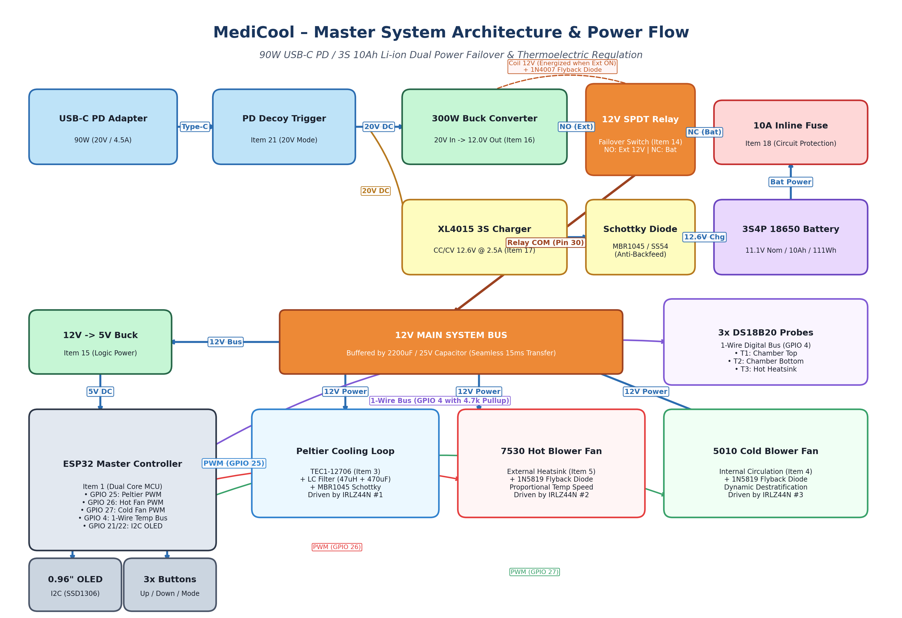
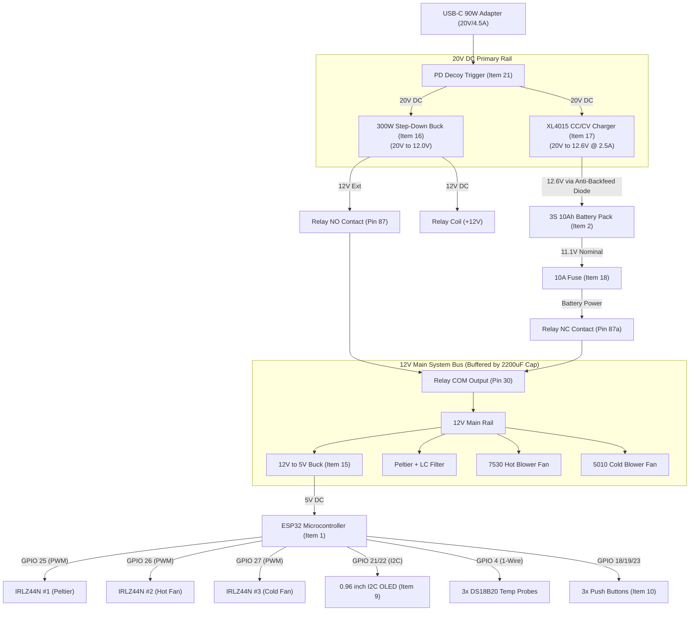
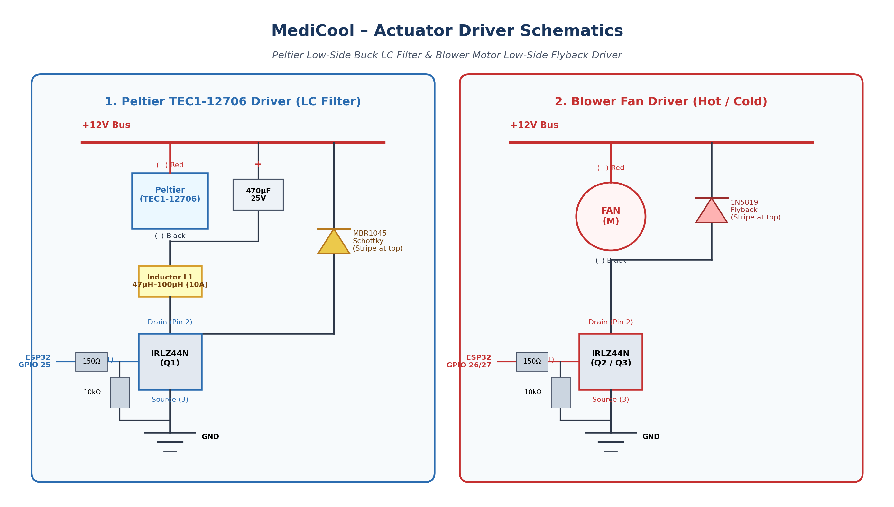

# MediCool – Complete Circuit Schematic & Physical Wiring Guide

**Document Version:** 2.1  
**Project:** MediCool (Portable Medicine Cooling System)  
**Tinkerers' Lab / Vishwakarma Awards**  
**Updated:** 18 November 2026

---

## 1. Complete Bill of Materials (BOM) & Component Requirements

### 1.1 Master Component List
| Sl No | Component | Specification / Rating | Quantity | Role in Circuit | Status / Action |
| :---: | :--- | :--- | :---: | :--- | :--- |
| 1 | **ESP32 DevKit** | 38-pin or 30-pin, Dual Core | 1 | Master controller (PWM, sensors, OLED) | Already available |
| 2 | **Lithium Battery Pack** | 3S 11.1V (12.6V max), 10 Ah | 1 | Portable backup power source | Selected |
| 3 | **Peltier Module** | TEC1-12706 (12V, 6A, ~72W) | 1 | Thermoelectric cooling engine | Selected |
| 4 | **Cold Blower Fan** | 5010 Turbo Blower (12V, double ball) | 1 | Internal chamber air circulation | Selected |
| 5 | **Hot Blower Fan** | 7530 High-CFM Blower (12V) | 1 | External heatsink forced heat exhaust | Selected |
| 6 | **Large Heatsink** | 90 × 90 mm finned aluminum | 1 | Hot-side heat dissipation | Selected |
| 7 | **Small Heatsink** | 40 × 40 mm finned aluminum | 1 | Cold-side heat absorption | Selected |
| 8 | **Power MOSFETs** | **IRLZ44N** (Logic-Level N-Channel) | 3 | Low-side switches (Peltier, Hot Fan, Cold Fan) | Selected |
| 9 | **OLED Display** | 0.96 inch I2C (SSD1306, 128×64) | 1 | Temperature, battery & status UI | Already available |
| 10 | **Push Buttons** | 6×6×5 mm tactile switches (NO) | 3 | Temp setpoint & UI mode controls | Pack of 10 |
| 11 | **Gate Pull-Down Resistors** | 10 kΩ, 1/4W | 3 | Keeps MOSFET gates safely OFF at boot | Standard passives |
| 12 | **1-Wire Pull-Up Resistor** | 4.7 kΩ, 1/4W | 1 | Pull-up for DS18B20 digital bus | Standard passives |
| 13 | **Thermal Paste** | High-conductivity compound (Noel) | 1 | Heatsink/Peltier interface thermal grease | Selected |
| 14 | **SPDT Changeover Relay** | 12V Coil, 5-Pin (10A–20A contacts) | 1 | Automatic failover: External 20V vs Battery | Selected |
| 15 | **Logic Buck Converter** | 12V $\to$ 5V (LM2596 / mini buck) | 1 | Regulated 5V supply for ESP32 & OLED | Selected |
| 16 | **Main Power Buck Converter** | **300W 20A DC-DC Step-Down Buck** | 1 | Steps 20V PD down to clean, regulated 12.0V | **Replace 150W Boost** |
| 17 | **3S Battery Charger Module** | **XL4015 Red 5A CC/CV Step-Down** | 1 | Charges 3S battery at 12.60V / 2.5A | Selected |
| 18 | **Fuse & Inline Holder** | 10A Blade / Glass DC Fuse | 1 | Battery branch overcurrent protection | Selected |
| 19 | **Master Power Switch** | Rocker / Toggle switch (10A rated) | 1 | Main circuit ON/OFF breaker | Selected |
| 20 | **Berg Strip Headers** | 40×1 Female single-row header | 2 | Sockets for ESP32 and daughterboards | Selected |
| 21 | **USB-C PD Decoy Trigger** | 100W PD/QC Trigger Board | 1 | Negotiates 20V DC from 90W USB-C charger | Selected |

---

### 1.2 Essential Additional Components to Add
These small components are required to complete the LC filter, flyback protection, and brownout buffering:

| Component | Specification | Quantity | Estimated Cost | Purpose |
| :--- | :--- | :---: | :---: | :--- |
| **DS18B20 Digital Probes** | Waterproof stainless-steel probe, 1m cable | **3** | ₹210 | Top chamber, Bottom chamber, and Hot heatsink. |
| **Toroidal Power Inductor** | $47\ \mu\text{H}\text{ to }100\ \mu\text{H}$, $\ge 6\text{–}10\text{ A}$ (thick wire) | 1 | ₹35 | LC filter inductor for smooth Peltier DC drive. |
| **Schottky Power Diodes** | **MBR1045** / **MBR2045** / **SS54** ($\ge 5\text{A}, 40\text{V}$) | 2 | ₹30 | 1 for Peltier LC filter, 1 for XL4015 anti-backfeed. |
| **Filter Capacitor** | $470\ \mu\text{F}\text{ to }1000\ \mu\text{F} / 25\text{V}$ Low-ESR Electrolytic | 1 | ₹10 | Ripple smoothing across Peltier terminals. |
| **Main Bus Buffer Capacitor** | $1000\ \mu\text{F}\text{ to }2200\ \mu\text{F} / 25\text{V}$ (or $35\text{V}$) Electrolytic | 1 | ₹15 | Bridges relay $15\text{ ms}$ changeover so ESP32 never restarts. |
| **Flyback Diodes** | **1N4007** (1 pc) and **1N5819 / SS34** (2 pcs) | 3 | ₹15 | 1N4007 across relay coil; 1N5819 across both blower fans. |
| **Gate Resistors** | $100\ \Omega\text{ to }150\ \Omega$, $1/4\text{ W}$ | 3 | ₹5 | Placed between ESP32 GPIOs and MOSFET gates. |
| **TO-220 Heatsink Clip** | Small aluminum clip-on heatsink | 1 | ₹10 | Clips onto the Peltier IRLZ44N MOSFET. |

---

## 2. Complete Architecture Block Diagram



### 2.1 Master System Flow (ASCII Map)
```text
[USB-C PD Adapter (90W)]
         │
         ▼
[PD Decoy Trigger (Item 21)] ── Negotiates 20V DC ──┬──► [XL4015 CC/CV Charger (Item 17)]
                                                    │         │ (Outputs 12.6V @ 2.5A)
                                                    │         ▼
                                                    │   [Schottky Diode D_chg (SS54/MBR1045)]
                                                    │         │ (Prevents reverse backfeed)
                                                    │         ▼
                                                    │   [3S 10Ah Battery Pack (Item 2)]
                                                    │         │
                                                    │         ▼
                                                    │   [10A Fuse (Item 18)]
                                                    │         │
                                                    │         ▼
                                                    │     Relay Pin 87a (NC - Normally Closed)
                                                    │         │
[300W Step-Down Buck (Item 16)] ◄───────────────────┘         │
(Steps 20V down to clean 12.0V)                               │
         │                                                    │
         ├─────────────────────────────────────► Relay Pin 87 (NO - Normally Open)
         │                                                    │
         ├─────► [Relay Coil (Pin 86)]                        │
         │       (Energizes relay when 20V is ON;             │
         │        1N4007 flyback diode across 85 & 86)        │
         │                                                    │
         └─────────────────────────────────┬──────────────────┘
                                           │
                                           ▼ (Relay COM Pin 30)
                                 [12V MAIN SYSTEM BUS]
                               (Buffered with 2200uF Cap)
                                           │
         ┌───────────────────┬─────────────┴─────────────┬────────────────────┐
         ▼                   ▼                           ▼                    ▼
[12V->5V Buck (Item 15)]  [Peltier TEC1-12706]   [7530 Hot Blower]   [5010 Cold Blower]
         │                   │ (via LC filter:           │ (with flyback      │ (with flyback
         │                   │  Inductor + Diode + Cap)  │  1N5819 diode)     │  1N5819 diode)
         ▼ (5V)              ▼ (GND switched)            ▼ (GND switched)     ▼ (GND switched)
     [ESP32]            [IRLZ44N #1]               [IRLZ44N #2]          [IRLZ44N #3]
  • OLED Display             │                           │                    │
  • 3x Push Buttons          └───────────────┬───────────┴────────────────────┘
  • 3x DS18B20 Probes                        ▼
    (Top, Bottom, Heatsink)        [Common Ground (GND)]
```

### 2.2 Interactive Power & Control Flowchart


---

## 3. Physical Pin-by-Pin Wiring & Circuit Details



### 3.1 Component Pin Orientations
* **IRLZ44N Power MOSFET (TO-220 Package)**:
  * Hold the MOSFET facing you (metal tab on back, plastic face with writing towards you, legs pointing downward):
    * **Pin 1 (Left Leg)** = **GATE**
    * **Pin 2 (Center Leg)** = **DRAIN** (electrically connected to the metal heatsink tab)
    * **Pin 3 (Right Leg)** = **SOURCE**
* **Diodes (1N4007, 1N5819, SS54, MBR1045)**:
  * The end marked with a **white or silver band/stripe** is the **CATHODE (–)**.
  * The unmarked black end is the **ANODE (+)**.
  * **Rule:** Current flows only from Anode $\to$ Cathode. In flyback/clamping roles, the Cathode always points towards $+12\text{ V}$.
* **Electrolytic Capacitors**:
  * **Longer leg** = **Positive (+)**
  * **Shorter leg** with the colored stripe marked `–` = **Negative (–)**
* **Toroidal Inductor**:
  * Has two heavy copper wire leads (Terminal A and Terminal B). **No polarity** (bidirectional).

---

### 3.2 The Peltier LC Filter Circuit (Visual Arrows & Physical Steps)

#### Visual Arrow Diagram:
```text
               +12V Main Bus (From Relay Pin 30)
                 │
                 ├───► [Peltier RED Wire (+)] ─────────┐
                 │                                     │
                 ├───► [Capacitor (+) Longer Leg]      │
                 │                                 [PELTIER MODULE]
                 ├───► [Diode CATHODE (Stripe End)]    │
                 │                                     │
                 │     [Peltier BLACK Wire (-)] ◄──────┘
                 │       │
                 │       ├───► [Capacitor (-) Shorter Leg]
                 │       │
                 │       └───► [Inductor Terminal A]
                 │
                 │             [Inductor Terminal B]
                 │               │
                 └───────────────┼─────────┐
                                 │         │
                                 │    [Diode ANODE (No Stripe)]
                                 │         │
                                 ▼         ▼
                              MOSFET Pin 2 (DRAIN)
                             ┌───────────────────┐
ESP32 GPIO 25 ──► [150Ω] ───►│ Pin 1 (GATE)      │
                             │                   │
                 ┌──────────►│ Pin 3 (SOURCE)    │
                 │           └───────────────────┘
                 │                     │
                 ▼                     ▼
               [10kΩ]                [GND]
                 │
                 ▼
               [GND]
```

#### Step-by-Step Soldering Instructions (Peltier LC Filter):
1. Take the **Peltier RED wire (+)**, the **Capacitor $470\ \mu\text{F}$ (+) Longer Leg**, and the **MBR1045 Schottky Diode CATHODE (stripe end)**. Solder all three directly to the **+12V Main Bus**.
2. Take the **Peltier BLACK wire (–)**, the **Capacitor $470\ \mu\text{F}$ (–) Shorter Leg**, and **Inductor Terminal A**. Solder all three together at one isolated junction node.
3. Take **Inductor Terminal B** and the **MBR1045 Schottky Diode ANODE (no stripe)**. Solder both directly to **MOSFET Pin 2 (DRAIN)** (the center pin).
4. Solder **MOSFET Pin 3 (SOURCE)** (the right pin) directly to **System Ground (GND)**.
5. Solder the **$10\text{ k}\Omega$ pull-down resistor** directly across **Pin 1 (GATE)** and **Pin 3 (SOURCE)**.
6. Connect the **$150\ \Omega$ resistor** between **ESP32 GPIO 25** and **MOSFET Pin 1 (GATE)**.

---

### 3.3 The Blower Fan Low-Side Driver Circuits (Hot & Cold Fans)

Both the **7530 Hot Blower Fan** and the **5010 Cold Blower Fan** use identical, independent driver circuits.

#### Visual Arrow Diagram:
```text
               +12V Main Bus (From Relay Pin 30)
                 │
                 ├───► [Fan RED Wire (+)] ────────────┐
                 │                                    │
                 └───► [Diode CATHODE (Stripe End)]   │
                                                   [12V BLOWER FAN]
                       [Diode ANODE (No Stripe)]      │
                         │                            │
                         │     [Fan BLACK Wire (-)] ◄─┘
                         │       │
                         ▼       ▼
                       MOSFET Pin 2 (DRAIN)
                      ┌───────────────────┐
ESP32 GPIO ──► [150Ω]►│ Pin 1 (GATE)      │
 (Pin 26 or 27)       │                   │
          ┌──────────►│ Pin 3 (SOURCE)    │
          │           └───────────────────┘
          │                     │
          ▼                     ▼
        [10kΩ]                [GND]
          │
          ▼
        [GND]
```

#### Step-by-Step Soldering Instructions (Fans):
1. Connect the **Fan RED wire (+)** and the **Flyback Diode CATHODE (stripe end)** directly to the **+12V Main Bus**.
2. Connect the **Fan BLACK wire (–)** and the **Flyback Diode ANODE (no stripe)** directly to **MOSFET Pin 2 (DRAIN)** (center pin).
3. Connect **MOSFET Pin 3 (SOURCE)** directly to **System Ground (GND)**.
4. Solder the **$10\text{ k}\Omega$ resistor** across **Pin 1 (GATE)** and **Pin 3 (SOURCE / GND)**.
5. Solder the **$150\ \Omega$ gate resistor** in series between the ESP32 GPIO pin and **MOSFET Pin 1 (GATE)**:
   * **Hot Fan (7530)**: Controlled by **ESP32 GPIO 26**.
   * **Cold Fan (5010)**: Controlled by **ESP32 GPIO 27**.

---

### 3.4 The Relay Automatic Changeover & Buffer Capacitor Circuit

```text
                                                 [300W Buck 12.0V OUT+]
                                                           │
                                                           ├───► Relay Pin 87 (NO)
                                                           │
                                                           ├───► Relay Pin 86 (Coil +)
                                                           │     (Cathode of 1N4007 Diode)
                                                           │
   [1N4007 Diode across 85 & 86]                           │
   Relay Pin 85 (Coil -) ────► GND                         │
                                                           │
   [Battery (+) via 10A Fuse] ─────────────────────────────┼───► Relay Pin 87a (NC)
                                                           │
                                                           ▼
                                                   Relay Pin 30 (COM)
                                                           │
                                                           ├───► [+] Buffer Cap (2200uF / 25V)
                                                           │      │
                                                           │     [-] ──► GND
                                                           │
                                                           ▼
                                                [+12V MAIN SYSTEM BUS]
```

* **Relay Pin 87 (NO)**: Receives regulated 12.0V from the 300W Buck Converter.
* **Relay Pin 87a (NC)**: Receives 11.1V–12.6V backup power from the 3S Battery through the 10A fuse.
* **Relay Pin 30 (COM)**: Outputs to the $+12\text{ V}$ Main System Bus.
* **Relay Coil (Pins 85 & 86)**: Pin 86 connects to the 12.0V Buck output; Pin 85 connects to GND. A **1N4007 diode** is wired across pins 85 and 86 (Stripe/Cathode on Pin 86, Anode on Pin 85).
* **Buffer Capacitor ($2200\ \mu\text{F} / 25\text{V}$)**: Solder directly between Relay Pin 30 (COM) and System GND. This prevents ESP32 brownout during the 15 ms contact switchover.

---

## 4. The 3-Sensor 1-Wire Digital Network

All 3 DS18B20 digital probes share the exact same 3 wires in parallel on a single ESP32 pin:

```text
   ESP32 3.3V ────────────────┬───────────────┬───────────────┬────────────────┐
                              │               │               │                │
                           [4.7kΩ]         Red (VCC)       Red (VCC)        Red (VCC)
                              │               │               │                │
   ESP32 GPIO 4 ──────────────┴─────────── Yellow (DATA)── Yellow (DATA)── Yellow (DATA)
                                              │               │                │
                                          [Sensor 1]      [Sensor 2]       [Sensor 3]
                                         (Chamber Top)  (Chamber Bottom) (Hot Heatsink)
                                              │               │                │
   Common GND ──────────────────────────── Black (GND)──── Black (GND)──── Black (GND)
```

* **Sensor 1 (Chamber Top)**: Placed in the upper third of the medicine storage chamber.
* **Sensor 2 (Chamber Bottom)**: Placed in the lower third near the base of the chamber (guards against freezing $<2^\circ\text{C}$).
* **Sensor 3 (Hot Heatsink)**: Thermally attached to the aluminum hot-side heatsink (safety cutoff if $\ge 65^\circ\text{C}$).

---

## 5. Intelligent Fan & Cooling Control Strategy

### 5.1 Cold-Side Internal Fan: Dynamic Homogenization
Instead of wasting battery by running continuously, the cold fan operates dynamically:
* **Active Cooling (Peltier ON)**: Cold fan runs at **$60\%\text{–}75\%$ PWM** to pull heat from the chamber air across the cold fins.
* **Target Temperature Reached (Peltier OFF)**:
  * The ESP32 computes thermal stratification: $\Delta T = |T_{top} - T_{bottom}|$.
  * If $\Delta T > 1.2^\circ\text{C}$ (air is separating): Fan turns **ON at $35\%$ PWM** for 30–45 seconds to mix the air.
  * Once $\Delta T \le 0.4^\circ\text{C}$ and average temperature is stable ($3^\circ\text{C}\text{–}5^\circ\text{C}$): **Fan turns completely OFF (0%)** to conserve battery.

### 5.2 Hot-Side Fan: Proportional Temperature Control
* If $T_{hot} < 35^\circ\text{C}$ and Peltier is OFF: **Hot Fan is completely OFF (0%)**.
* If Peltier turns ON: Hot fan starts at **$40\%$ PWM**.
* As heatsink warms up, speed ramps proportionally:
  * $40^\circ\text{C} \to 50\%$ PWM
  * $48^\circ\text{C} \to 70\%$ PWM
  * $\ge 55^\circ\text{C} \to 100\%$ PWM
* When Peltier turns OFF, keep hot fan running at $50\%$ for 60 seconds (post-cooling) to purge latent heatsink heat, then shut OFF.
* **Emergency Safety Cutoff**: If $T_{hot} \ge 65^\circ\text{C}$, immediately shut down the Peltier!

---

## 6. Master Point-to-Point Wiring Checklist

| Source Pin / Wire | Target Pin / Wire | Gauge | Function / Notes |
| :--- | :--- | :---: | :--- |
| **PD Decoy (+) Output** | **300W Buck Module `IN+`** | 18 AWG | Main 20V DC supply line. |
| **PD Decoy (+) Output** | **XL4015 Charger `IN+`** | 20 AWG | 20V DC charging feed line. |
| **PD Decoy (–) Output** | **Master Ground (GND)** | 18 AWG | Power ground return. |
| **300W Buck `OUT+` (12.0V)** | **Relay Pin 87 (NO)** | 18 AWG | External 12V supply to relay. |
| **300W Buck `OUT+` (12.0V)** | **Relay Pin 86 (Coil +)** | 24 AWG | Energizes coil when 20V is present. |
| **300W Buck `OUT-`** | **Master Ground (GND)** | 18 AWG | Ground return. |
| **XL4015 Charger `OUT+`** | **Schottky Diode Anode** | 20 AWG | Anti-backfeed charging output. |
| **Schottky Diode Cathode** | **Battery Positive (+) Terminal** | 18 AWG | 12.6V CC/CV charging current. |
| **XL4015 Charger `OUT-`** | **Master Ground (GND)** | 20 AWG | Charger ground return. |
| **Battery Positive (+) Terminal**| **10A Fuse Holder Input** | 18 AWG | Overcurrent protection. |
| **10A Fuse Holder Output** | **Relay Pin 87a (NC)** | 18 AWG | Battery backup input to relay. |
| **Battery Negative (–) Terminal**| **Master Ground (GND)** | 18 AWG | Battery ground. |
| **Relay Pin 85 (Coil –)** | **Master Ground (GND)** | 24 AWG | Coil ground. |
| **Across Relay Pins 85 & 86** | **1N4007 Diode** | Leads | Flyback diode (Cathode to Pin 86, Anode to Pin 85). |
| **Relay Pin 30 (COM)** | **12V Main System Bus (+)** | 16–18 AWG | Main switched 12V output. |
| **12V Main Bus (+) to GND** | **$2200\ \mu\text{F} / 25\text{V}$ Capacitor** | Leads | Buffer capacitor (Long leg to +12V, stripe to GND). |
| **12V Main Bus (+)** | **12V $\to$ 5V Buck Module `IN+`** | 22 AWG | Power feed to logic buck. |
| **12V $\to$ 5V Buck `OUT+` (5.0V)**| **ESP32 `VIN` / `5V` Pin** | 22 AWG | Powers ESP32. |
| **12V $\to$ 5V Buck `OUT-`** | **Master Ground (GND)** | 22 AWG | Logic ground. |
| **12V Main Bus (+)** | **Peltier Red Wire (+)** | 18 AWG | Direct 12V positive feed to TEC1-12706. |
| **12V Main Bus (+)** | **$D_1$ (MBR1045) Cathode** | 18 AWG | Freewheeling clamp for LC filter. |
| **Peltier Black Wire (–)** | **$L_1$ Inductor Terminal 1** | 18 AWG | Connects TEC negative to filter inductor. |
| **Across Peltier Red & Black** | **$C_1$ ($470\ \mu\text{F}$) Capacitor**| Leads | Ripple smoothing directly across TEC. |
| **$L_1$ Inductor Terminal 2** | **$Q_1$ (IRLZ44N) Drain Pin** | 18 AWG | Filtered switching node. |
| **$D_1$ (MBR1045) Anode** | **$Q_1$ (IRLZ44N) Drain Pin** | 18 AWG | Clamps inductor flyback. |
| **$Q_1$ Source Pin** | **Master Ground (GND)** | 18 AWG | Current return to ground. |
| **ESP32 GPIO 25** | **$Q_1$ Gate via $150\ \Omega$** | 24 AWG | Peltier PWM control. |
| **$Q_1$ Gate to GND** | **$10\text{ k}\Omega$ Resistor** | Leads | Gate pull-down resistor. |
| **12V Main Bus (+)** | **7530 Hot Fan Red Wire (+)** | 22 AWG | Hot-side fan power. |
| **7530 Hot Fan Black Wire (–)** | **$Q_2$ (IRLZ44N) Drain Pin** | 22 AWG | Hot fan ground-switched return. |
| **Across 7530 Fan (+ & –)** | **1N5819 / SS34 Diode** | Leads | Flyback diode (Cathode to +, Anode to –). |
| **ESP32 GPIO 26** | **$Q_2$ Gate via $150\ \Omega$** | 24 AWG | Hot fan PWM speed control. |
| **$Q_2$ Gate to GND** | **$10\text{ k}\Omega$ Resistor** | Leads | Hot fan pull-down resistor. |
| **12V Main Bus (+)** | **5010 Cold Fan Red Wire (+)** | 22 AWG | Cold-side fan power. |
| **5010 Cold Fan Black Wire (–)**| **$Q_3$ (IRLZ44N) Drain Pin** | 22 AWG | Cold fan ground-switched return. |
| **Across 5010 Fan (+ & –)** | **1N5819 / SS34 Diode** | Leads | Flyback diode (Cathode to +, Anode to –). |
| **ESP32 GPIO 27** | **$Q_3$ Gate via $150\ \Omega$** | 24 AWG | Cold fan PWM speed control. |
| **$Q_3$ Gate to GND** | **$10\text{ k}\Omega$ Resistor** | Leads | Cold fan pull-down resistor. |
| **ESP32 3.3V Pin** | **All 3 DS18B20 Red Wires** | 24 AWG | Sensor network power. |
| **ESP32 GPIO 4** | **All 3 DS18B20 Yellow Wires**| 24 AWG | 1-Wire shared data line. |
| **Between GPIO 4 & 3.3V** | **$4.7\text{ k}\Omega$ Resistor (Item 12)**| Leads | Mandatory 1-Wire pull-up resistor. |
| **All 3 DS18B20 Black Wires** | **Master Ground (GND)** | 24 AWG | Sensor ground. |
| **ESP32 3.3V Pin** | **OLED Display `VCC`** | 24 AWG | Display power. |
| **ESP32 GND Pin** | **OLED Display `GND`** | 24 AWG | Display ground. |
| **ESP32 GPIO 22** | **OLED Display `SCL`** | 24 AWG | I2C Clock. |
| **ESP32 GPIO 21** | **OLED Display `SDA`** | 24 AWG | I2C Data. |
| **ESP32 GPIO 18** | **Push Button 1 (Temp Up)** | 24 AWG | Active-low button to GND. |
| **ESP32 GPIO 19** | **Push Button 2 (Temp Down)** | 24 AWG | Active-low button to GND. |
| **ESP32 GPIO 23** | **Push Button 3 (Mode/Mute)** | 24 AWG | Active-low button to GND. |
| **Other side of all 3 Buttons** | **Master Ground (GND)** | 24 AWG | Button ground returns. |

---

## 7. Bench Calibration & Step-by-Step Commissioning

Follow this strict sequence to avoid burning any components during first power-up:

1. **Step 1: Calibrate the 300W Buck Converter (Item 16)**
   * Connect only the PD trigger (20V) to the 300W buck input.
   * Do NOT connect the relay or Peltier yet.
   * Measure the output with your multimeter and adjust the multi-turn trimpot until the output reads **strictly $12.00\text{ V}$**.
2. **Step 2: Calibrate the XL4015 Charger Module (Item 17)**
   * Connect 20V to the XL4015 input.
   * Adjust the **Voltage trimpot** until the output reads **strictly $12.60\text{ V}$** (or $12.80\text{ V}$ if measuring before the anti-backfeed Schottky diode).
   * Put your multimeter in $10\text{ A}$ current mode briefly across the output, and adjust the **Current trimpot** until it limits at **$2.5\text{ A}$**.
3. **Step 3: Test Relay Switchover Without Loads**
   * Wire the relay, buffer capacitor, and 5V buck converter.
   * Plug in the USB-C PD adapter: verify the relay clicks and the 12V bus measures $12.0\text{ V}$.
   * Connect the 3S battery to Pin 87a (NC).
   * Unplug the USB-C: verify the relay clicks back to NC and the 12V bus smoothly measures battery voltage ($\approx 11\text{–}12\text{ V}$) without dipping to zero.
4. **Step 4: ESP32 & MOSFET Testing**
   * Upload test firmware to the ESP32 to pulse GPIO 25, 26, and 27.
   * Verify the fans spin smoothly and change speed with PWM.
   * Finally, connect the Peltier module through its LC filter. Start with a conservative $30\%$ PWM and verify that one side gets icy cold while the heatsink side gets warm.

